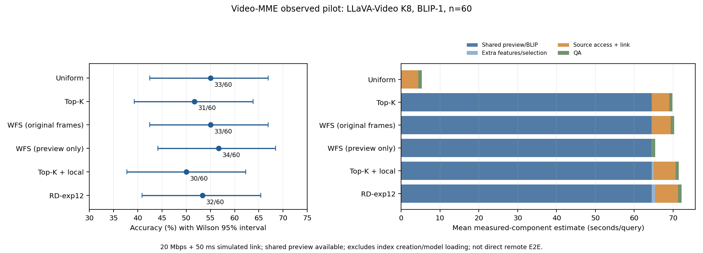

# 受控原片访问试点：结果与定位结论

本轮完成固定试点，**没有建立RD在该访问场景中的新精度或成本优势，结束这一固定实现，不接续MLVU、Qwen或全量问答**。这是已观察60题上的投入判断，不否定既有RD全量收益，也不是对所有成本约束视频获取方案的否定。

首次准备UTC日期2026-11-05；最终只读审计于2026-11-06完成。有效运行：`outputs/analysis/video_access__S1__llava8__20261105_r3/`。r1/r2的资产、暂停及失败记录保留，未重答或择优。

## 1. 固定实验与闭合

- Video-MME原冻结开发200题，按原顺序每时长前20个不同视频，共60题；没有按历史对错换题。该面板已被观察，不是盲测，不替代2700题主成绩。
- BLIP-1，FP32、batch16、TF32关闭、仅原问题；1 FPS/0.25秒相位。共享预览为等比例完整画面长边320、JPEG80。
- RD父版为exp12，K8；原种子/核心/扩窗/合并、条件2 FPS补查、支持/前缀及加权覆盖DP不变。细候选先按需取同规格JPEG，最终入选帧取PNG原图，所有方法同接口；预览不能充当原图缓存。
- LLaVA-Video-7B-Qwen2，原冻结权重和LMMs-Eval参考任务，BF16＋SDPA、384、qwen_1_5、贪心、种子2027、最多16新Token。全部正式输入8帧、1680视觉Token；音频、外部字幕、额外时间文字均未输入。
- 六组各60条，共360条方法结果：359次真实生成＋1条事前核验同输入共享；合成问答2次，解析失败0。既有基线没有作为本轮答案导入。
- 12视频/36源帧原片身份及RGB验收、12视频双表示等价验收、37项相关回归通过。实际关闭SSH再认证，同一后台PID/SID继续工作，准备22→23、BLIP账本1188→1201。
- 原始Token独立解码、原任务计分及标签隔离复核通过；普通QPY入口完成恢复新增生成0，1083份核心文件字节/mtime不变。继承125批的250个缓存/数组文件最终SHA256及mtime均不变。

## 2. 精度与成本

成本列是在共享预览已可用时，按每种方法独立计入共同检索费用的**已测组件＋实际响应链路重放估计**。条件为20 Mbps＋50 ms，排除一次性索引建设和模型加载；不是独立远端E2E，也不是边缘设备测试。

| 方法 | 正确数 | 准确率 | 原片服务增量返回MiB/题 | 组件估计秒/题 | 解码源帧/题 |
|---|---:|---:|---:|---:|---:|
| BASE-Uniform | 33/60 | 55.00% | 3.38 | 5.29 | 517.53 |
| BASE-BLIP-TopK | 31/60 | 51.67% | 3.62 | 69.83 | 358.38 |
| REF-WFS-SB，取原图 | 33/60 | 55.00% | 3.64 | 70.29 | 504.60 |
| CTRL-WFS-preview，仅预览 | 34/60 | 56.67% | 0 | 65.36 | 0 |
| CTRL-TopK-local，半秒邻接 | 30/60 | 50.00% | 3.63 | 71.44 | 615.15 |
| RD-1.2-exp12 | 32/60 | 53.33% | 3.57 | 72.13 | 795.23 |

WFS使用固定公开核心与本轮BLIP-1共同预览，不是作者默认前端/完整环境或公开发布选帧的复现。CTRL名称只属于本访问协议，不是新RD版本。服务返回量包括新增细JPEG和最终PNG，不能只计最终8张原图。



图示点估计及Wilson区间。各方法准确率区间很宽；点估计较高或较低不等于证明稳定优劣或统计等价。

| RD减参照 | 净增正确 | 百分点差 | 时长分层视频bootstrap 95%区间 |
|---|---:|---:|---:|
| RD−均匀 | −1 | −1.67 | [−13.33,+10.00] |
| RD−Top-K | +1 | +1.67 | [−6.67,+10.00] |
| RD−WFS取原图 | −1 | −1.67 | [−11.67,+8.33] |
| RD−WFS仅预览 | −2 | −3.33 | [−13.33,+6.67] |

重抽10000次、种子2027；每视频一题，保留短/中/长分层。全部15组配对四格题号和官方题型分组保存在原报告JSON及补充检查JSON。

| 方法 | 短20题 | 中20题 | 长20题 |
|---|---:|---:|---:|
| 均匀 | 15 | 9 | 9 |
| Top-K | 12 | 8 | 11 |
| WFS取原图 | 14 | 9 | 10 |
| WFS仅预览 | 14 | 10 | 10 |
| Top-K邻接 | 10 | 9 | 11 |
| RD-exp12 | 14 | 7 | 11 |

## 3. 哪些线索成立，哪些不能推断

**当前主要瓶颈没有因改变访问场景而消失。** 每题平均1027.08个粗位置，公共BLIP预处理/前向均值61.88秒，约占RD组件估计86%。仅减少CPU选择或传输细JPEG，无法消除逐题全片相关性扫描。全片预览虽然共享，问题相关ITM不能按不同问题直接复用；CLS也不足以替代完整ITM。

源预览长边320仍会经过BLIP官方384×384预处理，没有减少粗评分位置或网络输入规模。因此，低清来源主要改变获取成本与信息质量，不会自动按源像素比例降低BLIP视觉前向算量。这也说明当前“低成本预览”并未把整个检索前端变成低成本。

**本实现没有取得解码或传输优势。** 所有取原图方法最终均获取8个原图；RD额外获取668个细预览，不新增其ITM，平均仍解码795.23源帧，高于WFS的504.60。RD相对WFS约减少1.86%的服务返回字节，但组件估计反而增加约2.62%，未达到20%成本下降门。简单邻接额外480个细ITM位置，正确数也未增加。

**不能把“预览34、原图33”解释为降低画质有效。** 两种WFS输入的源帧完全相同，预测有7题变化，对错仅491-2一题变化；该题已有歧义记录。除它以外未观察净纠正，不能证明高清无价值，也不能证明低清具有新优势。

**面板本来没有重现父版的全量优势。** 同60题的历史清晰前端成绩为均匀33、Top-K29、exp07为32、exp12为33；本轮均匀60题的RGB、官方像素、提示Token及预测全部与历史一致。新低清前端Top-K变为31、exp12变为32，因此不能简单归因为“低清整体削弱所有检索”，也不能用60题否定原2700题的正收益。原问题分数、视觉表征及其下游选择会共同随输入质量变化，本轮不是单因素机制归因。

当前能支持的结论是：**没有证据表明，把冻结exp12直接搬到这一原片访问协议，就能获得新的精度—成本优势。** 这不足以支撑当前论文直接以“边缘/远端场景”作为优势卖点。

## 4. 预设门与未执行阶段

8 MiB预算下，均匀59/60题、Top-K和邻接各58/60题完整计划可执行，其他三组60/60；32 MiB均60/60。超预算题不附用完整答案，主分母仍60。该指标只检查固定访问计划，不表示实现了按剩余成本主动停止的策略。

fast/limited两链路、8/32 MiB四个检查点全部未通过资源门。RD预算内正确数最多32，WFS仅预览始终34，精度和成本条件均不成立。MLVU70题清单已冻结，但正式评分/问答为0；此前6个MLVU视频只用于零模型工程验收。没有启动Qwen32或全量实验。

不因负结果调整预览分辨率、窗口、密度或阈值，不追加新版本。保留原全量成果，结束本固定应用转换试点。若未来研究成本约束获取，需要真实业务的访问约束与新的价值依据；本轮没有证明该方向普遍不可行，也没有开发新获取策略。

## 5. 资产与性能边界

- 60视频61625个粗位置，核对解码1652268源帧；JPEG约642.29 MiB，不含索引/封装，原视频约5.66 GiB。单视频建设时间累加8352.09秒，不是批次墙钟且含先前工程资产。索引建设是所有方法的共同成本，不是RD独有收益。
- r3选择准备工作进程跨度3264.46秒，处理六策略共享资产与文件校验，不是单方法耗时；QA工作进程跨度572.26秒，包含加载和合成。LLaVA两进程加载83.07/89.64秒，S1加载及合成验收11.37/11.15秒。
- 406份原片服务响应＋60份初始预览包，共466个包，三档1398份重放记录。累计实际响应测量946.28秒、5.44 GB；这只是本机受控链路重放，不是跨地域网络实测。
- RDI额外纯视觉位置668，新增细ITM为0；邻接对照额外细ITM480。继承125批只核验复用，环境兼容验收另有2次合成BLIP前向、0问答，其单独加载耗时未完整测量，不补造为0。
- 计时包含当前服务的软解码、PNG/JPEG返回规格和受控并发；不能推广为任意MP4对象存储、真实边缘设备或能耗优势。成本是分项合成，未建模跨步骤重叠，不能称独立原片E2E。

## 6. 工程异常、恢复与复算

首次前端依赖预检不完整，导致WFS在缺少scikit-learn的环境导入失败；125批已完成输出全部保留。改用已有完整环境，关键依赖不变、合成ITM/视觉数值误差0，再继续。原协调环境还缺cv2，采集/重放结束后的最终审计暂停；在完整QPY环境仅恢复后处理，未更改选择、输出或计分规则，未新增生成。原异常记录与`failure_resolved.json`并存，不能声称全链路一次无异常完成。

普通执行和恢复入口统一使用完整环境：

```bash
/App/conda/envs/explore_video_qa_lmms/bin/python scripts/run_video_access_pilot.py coordinate \
  --root outputs/analysis/video_access__S1__llava8__20261105_r3
```

完成恢复实际返回0、新生成0，1083份核心文件字节/mtime不变。额外核验继承125批的250个文件不变；独立官方计分用真实标签在完整返回之后重算，记录在`official_postgeneration_scoring.json`。模型路径和旧冻结算法均未改变。

可复算资产在运行目录：`protocol.json`、`manifest.json`、`labels.json`、`qa/videomme/plan.json`、`reports/videomme.json`、`reports/supplemental_checks.json`、`reports/final/`、`network_replay/`、`independent_completion_audit.json`及`final_cache_lineage_audit.json`。报告生成入口为`scripts/finalize_video_access_pilot.py`，无模型调用。图表首次版和布局修订版均保留，原统计不改写。
